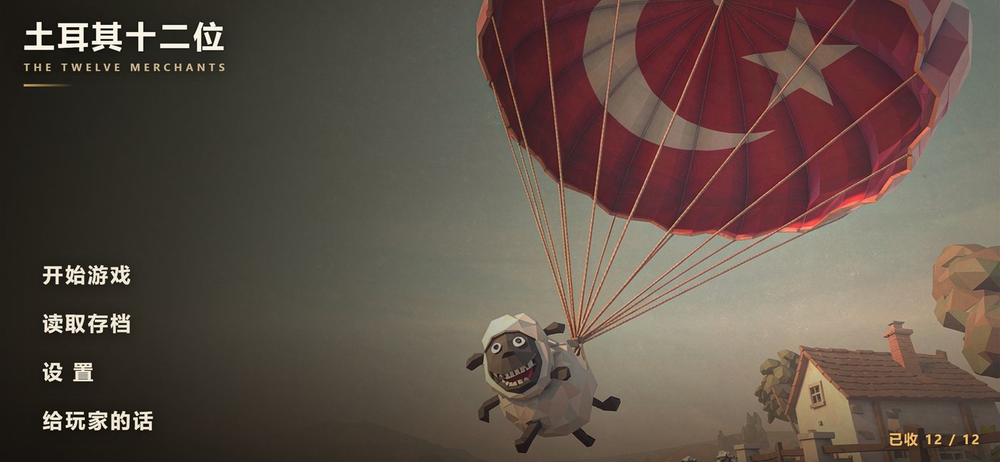
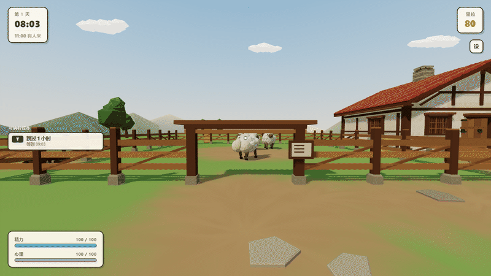

# 土耳其十二位 · THE TWELVE MERCHANTS

**▶ [点这里直接玩](https://guo12240131.github.io/shierwei-game/)** —— 不用下载、不用注册，打开就是游戏。
手机上打开后可以「添加到主屏幕」，之后全屏、断网也能玩。

> 第一次打开要下载约 3 MB（单文件游戏，模型、贴图、48 段音效全部内嵌在 html 里）。
> 国内网络可能要等一会儿，**之后再打开是秒开**（Service Worker 已经把它存进本地）。
> 海外访问很快——慢只慢在这条线路上，不是页面本身重。

## 装到桌面（下载安装包）

不想每次开网址、想要一个桌面图标的话，三个包在这里（[Release 页面](../../releases/tag/v1.0)）：

| 机器 | 下载 | 装完是什么样 |
|---|---|---|
| **Windows 10 / 11** | [`shierwei-1-windows.zip`](https://github.com/Guo12240131/shierwei-game/releases/download/v1.0/shierwei-1-windows.zip) · 1.7 MB | 解压 → 双击 `安装并启动.bat` → 桌面多一个带图标的「土耳其十二位」，点开是无地址栏的独立窗口 |
| **Android 7+** | [`shierwei-2-android.zip`](https://github.com/Guo12240131/shierwei-game/releases/download/v1.0/shierwei-2-android.zip) · 4.6 MB | 解压 → 把 `土耳其十二位.apk` 拷到手机 → 点一下装，桌面出图标 |
| **iPhone / iPad** | [`shierwei-3-ios.zip`](https://github.com/Guo12240131/shierwei-game/releases/download/v1.0/shierwei-3-ios.zip) · 3.0 MB | Safari 打开本页 → 分享 →「添加到主屏幕」；包里另附说明和一份可安装的描述文件 |

三份都**离线**：three.js、封面、45 段音效全部打包在文件里，装完断网照玩。
安卓的 apk 一条权限都没有——连联网权限都没申请。

> 附件名是 ASCII 的，因为 GitHub 会把中文附件名过滤成 `-1-.Windows.zip`；解压出来的文件夹名仍是中文。
> 国内下不动的话，同一个包也在[下载页](https://turkey-twelve.app.workbuddy.host/download.html?sharecode=TL6KX32B27)上（实测 4.8 MB 约 2 秒）。链接末尾那串 `sharecode` 不能删——这个域名靠它第一次放行。

---

## 创作意图

这个故事的起点，是一句骂人的话。

几百年来，有人反复讲土耳其人和羊的传闻，讲到它成了一个梗——不用了解、不用负责，只要重复。
我们把被重复的那一方，做成一间你能走进去的屋子：主角给每只羊取名字，因为他知道它们是谁；
而那些从路尽头走来收钱的人，是一批又一批来过的征服者。

我们不打算考谁。只希望你在宰掉第一只羊的时候，手指能停一下。

---

## 这是一个什么故事

一个土耳其牧羊人的一天：挤奶、等商人、配种、睡觉。

它看起来像个粗糙的沙盒游戏——我一开始也是这么跟人介绍的。
但有些东西写在机制里，没有说出来：

- 羊不是牲畜，是他的同胞，所以他给每一只**取名字**；
- 他施的那个「法术」，是这片土地上被人拿来取笑的一件事；
- 向他收钱的人不是随机刷出来的 NPC，是**一批又一批来过的征服者**；
- 杀羊和剪毛削掉的不是金币，是羊的**心理健康上限**——不可逆。

游戏里有一页「给玩家的话」，玩到那里你会看到完整的自述。这里就不全抄了。

---

## 一天是怎么过的

| 时间 | 要做什么 |
|---|---|
| 上午 | 去工具板拿桶，给羊挤奶（一只羊一天只挤一次） |
| **11:00** | 商人从土路那头走过来。对着他打开货单，卖奶、卖羊、买材料 |
| 白天 | 绕到羊的后面施法配种，三天后生一只羔子 |
| 19:00 后 | 上床，睡一觉到第二天，奶重新有了 |

钱是**里拉**。两档难度：**故事难度**（没压力，三十天不死一只）、**真实难度**（钱永远不够，中位活十五到二十二天）。

---

## 操作

| | 键盘鼠标 | 触屏 |
|---|---|---|
| 走路 | `W A S D`，`Shift` 跑 | 左摇杆 |
| 看四周 | 划鼠标 | 划画面 |
| 交互 / 拿东西 / 睡觉 | `E` | 「交互」键 |
| 施法（配种） | 鼠标右键 | 「施法」键 |
| 宰杀 | 鼠标左键 | 「宰杀」键 |
| 放下手里的东西 | `Q` | 「丢下」键 |
| 跳过一个小时 | `T` | 「跳 1 时」键 |

手机建议横屏。

---

## 技术

- **整个游戏就是一个 `index.html`**（2.8 MB，约一万行）。three.js 内联，贴图和 48 段音效全部 base64 进文件——
  **零外部请求**，拷到断网的机器上双击就能玩。
- **PWA**：装了 manifest 和 Service Worker，装到桌面后全屏、无地址栏、离线可玩。
- **一份源码同时伺候两种输入**：靠 `pointer: coarse` 判断，桌面给键鼠、手机给摇杆，不是两个版本。
- 数值不是拍脑袋定的，另有一个模拟器跑经济曲线和心理健康曲线，校准到「故事零死亡 / 真实中位二十天」。

---

## 关于「AI 生成」

**这个游戏的代码、场景建模、音效和大部分文字，是 AI 生成的。**

这不是藏在角落里的一句免责声明，而是这个项目真实的样子：

| 谁做的 | 做了什么 |
|---|---|
| **AI** | 全部代码（约一万行单文件）· 场景与羊的程序化建模 · 48 段音效合成 · 美术素材 · 界面文案的成稿 |
| **作者** | 这个题材和这个立场 · 「给玩家的话」里那些句子 · 美术方向 · 每一轮的验收（经常整版推翻重做）· 决定留下什么、删掉什么 |

有一点想说明白：**AI 不会自己挑这个题目。**
是作者先把「用羊指代同胞、用收钱的人指代征服者」这件事定了，AI 才把它写成机制。
机器负责把它做出来，立场是人给的。

---

## 许可

个人作品，保留所有权利。**看、玩、学习都可以；商用和二次分发请先联系。**

 

Cover art & in-game assets generated with AI. Built with three.js r170.
